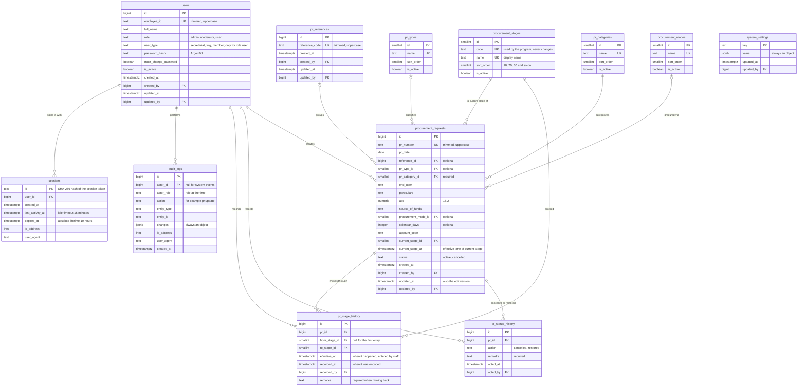

# Database Design

This document describes the PostgreSQL database of the Procurement Monitoring System (PMS) as it currently exists: its tables, how they relate, and the rules the database enforces. The source of truth is the migration files in `db/migrations/`; this document explains them. The reasons behind each decision are in `docs/decisions.md`.

**Last updated:** October 15, 2026
**Database:** PostgreSQL 18, running in Docker (`compose.yaml`)
**Migrations:** dbmate, 10 migrations applied

---

## 1. Conventions

| Topic        | Convention                                                                | Example                             |
| ------------ | ------------------------------------------------------------------------- | ----------------------------------- |
| Table names  | snake_case, plural                                                        | `procurement_requests`              |
| Column names | snake_case                                                                | `pr_number`                         |
| Foreign keys | `<thing>_id`                                                              | `procurement_mode_id`               |
| Timestamps   | `<event>_at`, type `timestamptz`                                          | `created_at`, `effective_at`        |
| Booleans     | `is_` or `must_` prefix                                                   | `is_active`, `must_change_password` |
| Primary keys | `bigint GENERATED ALWAYS AS IDENTITY`; `smallint` for small lookup tables | `id`                                |
| Text         | `text`, with a `CHECK` on length and trimming where useful                |                                     |
| Money        | `numeric(15,2)`, never floating point                                     | `abc`                               |
| Constraints  | always named, `<table>_<column>_<rule>`                                   | `users_role_valid`                  |

- **Fixed value sets the program depends on** (role, user type, PR status) are `text` columns with a `CHECK` constraint.
- **Lists administrators may change** (stages, procurement modes, PR types, categories) are lookup tables. Their rows are deactivated, never deleted.
- **Identifiers are normalized:** PR Number, Reference ID, and Employee ID are stored trimmed and uppercase, enforced by `CHECK` constraints.
- **Nothing important is deleted:** users are disabled, PRs are cancelled, lookup values are deactivated.
- **`updated_at` is maintained by a trigger** (`set_updated_at`). `created_by` and `updated_by` are set by the application.
- **The application reads IDs as text,** because `bigint` values can exceed what JavaScript represents exactly.

## 2. Migrations

| #   | File (suffix)                 | Creates                                                                          |
| --- | ----------------------------- | -------------------------------------------------------------------------------- |
| 1   | `init`                        | `pg_trgm` extension; `set_updated_at()` trigger function                         |
| 2   | `create_users`                | `users`                                                                          |
| 3   | `create_lookup_tables`        | `procurement_stages`, `procurement_modes`, `pr_types`, with their reference data |
| 4   | `create_pr_categories`        | `pr_categories`, with Office, Hospital, 7K / SEF                                 |
| 5   | `create_pr_references`        | `pr_references`                                                                  |
| 6   | `create_procurement_requests` | `procurement_requests`, with search indexes                                      |
| 7   | `create_pr_history_tables`    | `forbid_changes()` function; `pr_stage_history`; `pr_status_history`             |
| 8   | `create_audit_logs`           | `audit_logs`                                                                     |
| 9   | `create_sessions`             | `sessions`                                                                       |
| 10  | `create_system_settings`      | `system_settings`, with the default `report_signatories` row                     |

## 3. Entity Relationship Diagram

For readability, the diagram omits most `created_by` / `updated_by` links to `users`.



## 4. Tables

| Table                  | Purpose                                                              | Append-only |
| ---------------------- | -------------------------------------------------------------------- | :---------: |
| `users`                | Accounts, roles, user types, password hashes                         |             |
| `sessions`             | Sign-in sessions for idle and absolute timeouts                      |             |
| `procurement_stages`   | The 11 procurement stages, in order                                  |             |
| `procurement_modes`    | Competitive Bidding, Small Value Procurement, Negotiated Procurement |             |
| `pr_types`             | Goods, Medicines, Infrastructure, Services                           |             |
| `pr_categories`        | Office, Hospital, 7K / SEF                                           |             |
| `pr_references`        | Reference IDs used to consolidate PRs                                |             |
| `procurement_requests` | The PRs                                                              |             |
| `pr_stage_history`     | Every stage change                                                   |      ✓      |
| `pr_status_history`    | Every cancellation and restoration                                   |      ✓      |
| `audit_logs`           | Every audited action                                                 |      ✓      |
| `system_settings`      | Configurable values (report signatories)                             |             |

**Planned, not yet built:** `attachments` (Phase 7).

## 5. Indexes

Beyond primary keys and unique constraints:

| Table                  | Index                                                 | Supports                                   |
| ---------------------- | ----------------------------------------------------- | ------------------------------------------ |
| `procurement_requests` | `(status, current_stage_id)`                          | PR list, dashboard, reports                |
| `procurement_requests` | `(pr_date)`                                           | Date filters, report periods, list sorting |
| `procurement_requests` | `(reference_id)` where not null                       | PRs under one Reference ID                 |
| `procurement_requests` | GIN trigram on `pr_number`, `particulars`, `end_user` | "Contains" searches                        |
| `pr_stage_history`     | `(pr_id, effective_at DESC)`                          | Stage timeline                             |
| `pr_status_history`    | `(pr_id, acted_at DESC)`                              | Cancellation history                       |
| `audit_logs`           | `(created_at DESC)`                                   | Audit log page                             |
| `audit_logs`           | `(actor_id, created_at DESC)`                         | "Done by" filter, own activity             |
| `audit_logs`           | `(entity_type, entity_id)`                            | Login lockout, entity history              |
| `sessions`             | `(user_id)`, `(expires_at)`                           | Signing users out, cleanup                 |

## 6. Triggers

| Trigger function   | Tables                                                                                 | Effect                            |
| ------------------ | -------------------------------------------------------------------------------------- | --------------------------------- |
| `set_updated_at()` | `users`, all lookup tables, `pr_references`, `procurement_requests`, `system_settings` | Sets `updated_at` on every update |
| `forbid_changes()` | `pr_stage_history`, `pr_status_history`, `audit_logs`                                  | Refuses every update and delete   |

The append-only trigger guards against application mistakes, not against a database superuser, who can disable triggers. Production will use a restricted database account (Phase 8).

## 7. Where each rule is enforced

| Rule                                                                                     | Enforced by                                    |
| ---------------------------------------------------------------------------------------- | ---------------------------------------------- |
| PR Number, Reference ID, Employee ID unique and normalized                               | Database (`UNIQUE`, `CHECK`)                   |
| Role and user type valid; user type present only for regular users                       | Database (`CHECK`)                             |
| ABC greater than zero; Calendar Days greater than zero                                   | Database (`CHECK`)                             |
| Free-text fields stored without leading or trailing spaces                               | Database (`CHECK`) and application             |
| PR status is `active` or `cancelled`                                                     | Database (`CHECK`)                             |
| Stage effective time not in the future                                                   | Database (`CHECK`) and application             |
| Cancel and restore remarks required                                                      | Database (`NOT NULL`, `CHECK`) and application |
| History and audit records cannot be changed or deleted                                   | Database (trigger)                             |
| PRs with history cannot be deleted                                                       | Database (foreign keys)                        |
| Settings and audit details stored as JSON objects                                        | Database (`CHECK`)                             |
| Stage change, history, and audit saved together                                          | Database transaction                           |
| Who may perform each action                                                              | Application (`src/lib/permissions.ts`, tested) |
| Remarks required when moving a PR back                                                   | Application                                    |
| Effective time not earlier than the PR's current stage time                              | Application                                    |
| Only Admins and Moderators reopen Completed PRs                                          | Application                                    |
| Cancelled PRs cannot be edited or moved                                                  | Application                                    |
| Edits refused if the PR changed since the form opened                                    | Application (version check on `updated_at`)    |
| Only active options for new PRs; current options kept when editing                       | Application                                    |
| An Admin cannot change their own role or disable themselves; the last active Admin stays | Application, with Admin rows locked            |
| Five failed sign-ins in 15 minutes lock the Employee ID                                  | Application (counted from `audit_logs`)        |

## 8. Stage codes

The program refers to stages by `code`. Display names can be changed without affecting the program.

| Order | Code                           | Name                         |
| ----- | ------------------------------ | ---------------------------- |
| 10    | `received`                     | Received                     |
| 20    | `pre_procurement`              | Pre-Procurement              |
| 30    | `posting`                      | Posting                      |
| 40    | `pre_bid`                      | Pre-Bid                      |
| 50    | `opening`                      | Opening                      |
| 60    | `evaluation`                   | Evaluation                   |
| 70    | `post_qualification`           | Post-Qualification           |
| 80    | `notice_of_post_qualification` | Notice of Post-Qualification |
| 90    | `notice_of_award`              | Notice of Award              |
| 100   | `notice_to_proceed`            | Notice to Proceed            |
| 110   | `completed`                    | Completed                    |

The delivery due date is the latest `notice_to_proceed` entry plus the PR's Calendar Days. It is calculated in two places that must agree: `getDeliveryStatus()` in `src/lib/delivery.ts` and `getUpcomingDeliveries()` in `src/server/queries/dashboard.ts`.

## 9. Settings keys

| Key                  | Value shape                                                       | Edited on              |
| -------------------- | ----------------------------------------------------------------- | ---------------------- |
| `report_signatories` | `{ preparedBy: { name, position }, notedBy: { name, position } }` | Settings page (Admins) |

## 10. Consistency checks

Each query should return no rows.

Every PR's current stage matches its latest stage history entry:

```sql
SELECT p.pr_number
FROM procurement_requests p
WHERE p.current_stage_id <> (
  SELECT h.to_stage_id FROM pr_stage_history h
  WHERE h.pr_id = p.id
  ORDER BY h.effective_at DESC, h.id DESC
  LIMIT 1
);
```

Every audit entry's details are a JSON object or empty:

```sql
SELECT id, action FROM audit_logs
WHERE changes IS NOT NULL AND jsonb_typeof(changes) <> 'object';
```
