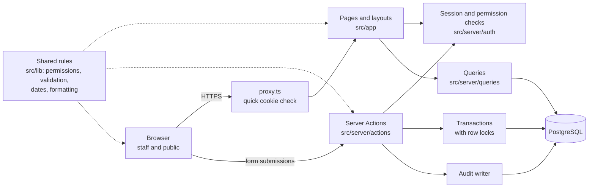
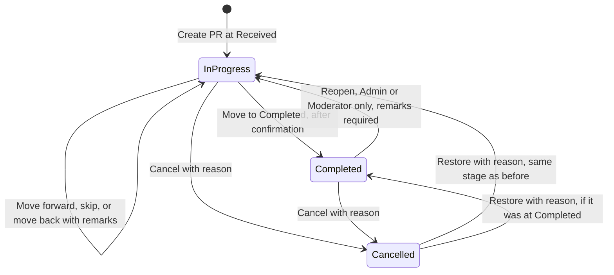
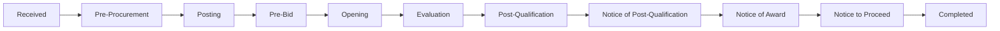
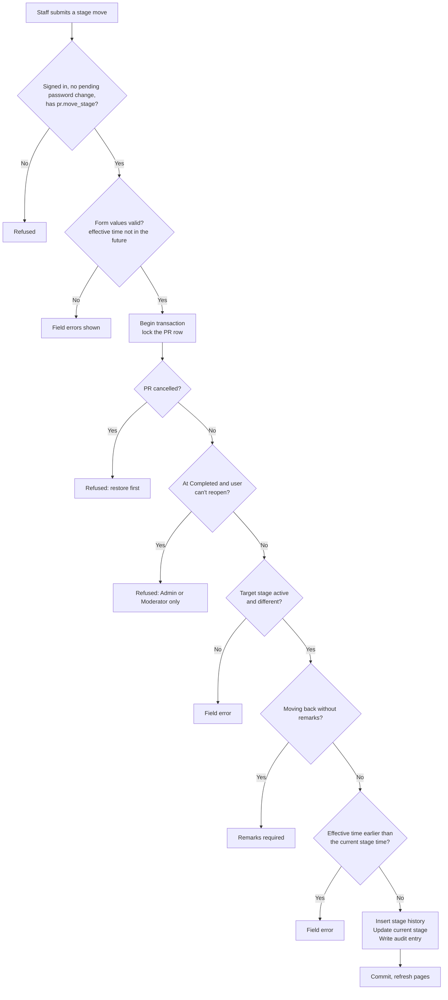
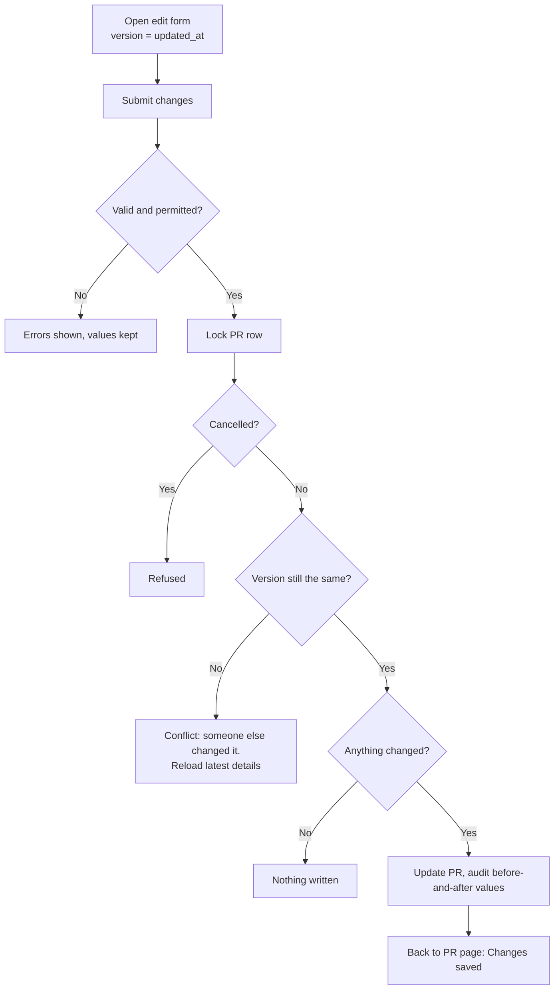
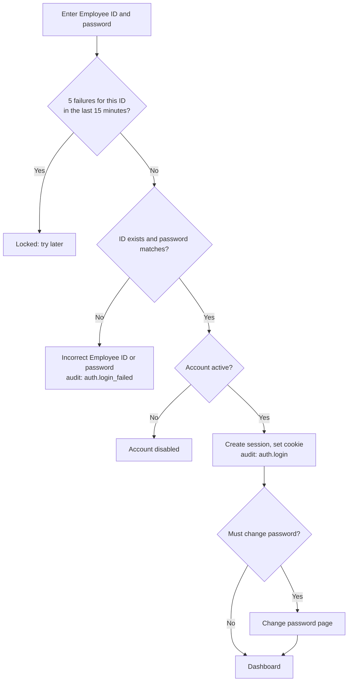
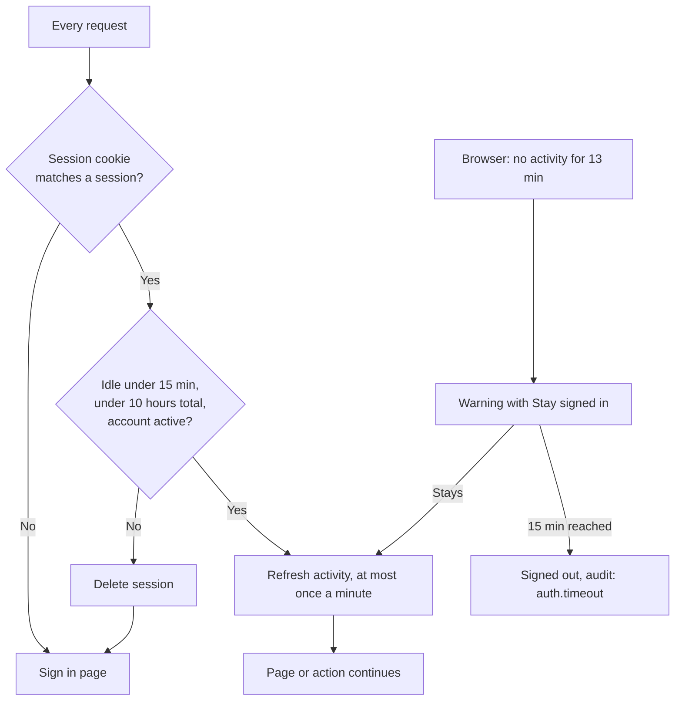
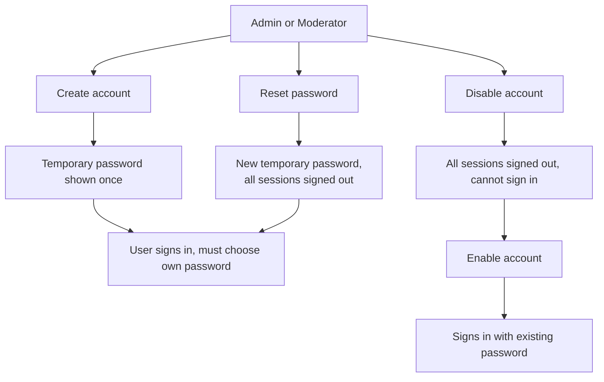

# System Overview

A single reference for the Procurement Monitoring System (PMS) as it currently stands: the technology, the architecture, the pages and who can use them, and how the main processes flow. For the database, see `docs/database.md`; for the reasons behind each decision, see `docs/decisions.md`.

**Last updated:** October 15, 2026
**Status:** all features in the original specification are built, except attachments (Phase 7). Deployment (Phase 8) is next.

---

## 1. Technology

| Layer           | Technology                                                         | Purpose                                           |
| --------------- | ------------------------------------------------------------------ | ------------------------------------------------- |
| Framework       | Next.js 16 (App Router), React 19                                  | Pages, server rendering, Server Actions           |
| Language        | TypeScript                                                         | Type checking across the whole codebase           |
| Styling         | Tailwind CSS 4, design tokens in `globals.css`                     | Light and dark themes, print styles               |
| Fonts           | Public Sans (headings), Inter (text), JetBrains Mono (identifiers) | Self-hosted through `next/font`                   |
| Database        | PostgreSQL 18 in Docker                                            | All data, with constraints and triggers           |
| Database access | postgres.js, parameterized SQL                                     | Queries safe from SQL injection                   |
| Migrations      | dbmate, plain `.sql` files                                         | Versioned database changes                        |
| Validation      | Zod                                                                | Forms, URLs, environment variables, stored JSON   |
| Passwords       | Argon2id (`@node-rs/argon2`)                                       | OWASP-recommended hashing                         |
| Tests           | Vitest                                                             | Permission matrix, report periods, delivery dates |
| Quality         | ESLint, Prettier                                                   | Zero-warning lint, consistent formatting          |
| Version control | Git and GitHub, one branch per feature, squash and merge           | Reviewable, one-commit-per-feature history        |

## 2. Architecture



**Principles that hold everywhere:**

- **Every page and every action checks permissions on the server.** Hiding a button is convenience; the server check is the security.
- **Queries never decide permissions;** the page or action calling them does. Visibility rules that limit rows (audit log, users list, public page) are applied inside the query's `WHERE`, so hidden rows never leave the database.
- **Related writes happen in one transaction:** a change, its history entry, and its audit entry are saved together or not at all.
- **Rules shared by the browser and the server live once in `src/lib`** (permissions, password rules, form validation), so the two can't disagree.
- **Every value from a form or URL is validated;** invalid URL values are ignored rather than causing errors.

## 3. Folder structure

```
pms/
├── compose.yaml            PostgreSQL container
├── db/
│   ├── migrations/         10 dbmate migrations
│   └── seeds/              Sample PRs (development only)
├── docs/
│   ├── decisions.md        Decisions log
│   ├── database.md         Database design
│   ├── system-overview.md  This document
│   ├── known-issues.md
│   └── lessons/            Build notes, one per lesson
├── scripts/
│   └── create-admin.ts     Creates the first Administrator
├── .github/
│   └── pull_request_template.md
└── src/
    ├── app/
    │   ├── (public)/       Home, public procurement
    │   ├── (auth)/         Sign in, change password
    │   ├── (app)/          Staff pages (sign-in required)
    │   ├── api/health/     Health check
    │   └── robots.ts
    ├── components/
    │   ├── ui/             Button, Input, Table, Badge, Pagination…
    │   └── features/       Feature components (procurement, users, audit…)
    ├── lib/                Shared rules, validation, formatting, config
    ├── server/
    │   ├── auth/           Sessions, passwords, permission checks
    │   ├── actions/        Server Actions (all writes)
    │   ├── queries/        Read queries
    │   ├── audit.ts        Audit writer
    │   └── db.ts           Connection pool and transactions
    └── proxy.ts            Redirects visitors without a session cookie
```

## 4. Pages and access

| Page               | Path                  | Who can open it                                            |
| ------------------ | --------------------- | ---------------------------------------------------------- |
| Home               | `/`                   | Everyone                                                   |
| Public procurement | `/procurements`       | Everyone                                                   |
| Sign in            | `/login`              | Visitors (signed-in users are redirected to the dashboard) |
| Change password    | `/change-password`    | Signed-in users; forced after a temporary password         |
| Dashboard          | `/dashboard`          | All staff                                                  |
| Requests (PR list) | `/requests`           | All staff                                                  |
| New PR             | `/requests/new`       | Admin, Moderator, Secretariat                              |
| PR details         | `/requests/[id]`      | All staff                                                  |
| Edit PR            | `/requests/[id]/edit` | Admin, Moderator, Secretariat, TWG                         |
| Reports            | `/reports`            | All staff                                                  |
| Audit log          | `/audit-log`          | All staff (each sees their permitted scope)                |
| Users              | `/users`              | Admin, Moderator                                           |
| Add user           | `/users/new`          | Admin, Moderator                                           |
| Edit user          | `/users/[id]`         | Admin (any account), Moderator (regular users only)        |
| Settings           | `/settings`           | Admin                                                      |
| Design preview     | `/styleguide`         | All staff (development only)                               |
| Health check       | `/api/health`         | Everyone (for monitoring)                                  |

Pages a user can't access respond as "not found".

## 5. Roles and permissions

Implemented in `src/lib/permissions.ts` and verified by `src/lib/permissions.test.ts`.

| Permission                          | Admin | Moderator | Secretariat | TWG | Member |
| ----------------------------------- | :---: | :-------: | :---------: | :-: | :----: |
| View PRs and reports                |   ✓   |     ✓     |      ✓      |  ✓  |   ✓    |
| Create PR                           |   ✓   |     ✓     |      ✓      |     |        |
| Edit PR details                     |   ✓   |     ✓     |      ✓      |  ✓  |        |
| Move PR stage                       |   ✓   |     ✓     |      ✓      |  ✓  |        |
| Cancel / restore PR                 |   ✓   |     ✓     |      ✓      |  ✓  |        |
| Reopen a Completed PR               |   ✓   |     ✓     |             |     |        |
| Upload attachments (planned)        |   ✓   |     ✓     |      ✓      |  ✓  |        |
| Delete any attachment (planned)     |   ✓   |     ✓     |             |     |        |
| View and manage regular users       |   ✓   |     ✓     |             |     |        |
| Manage Admin and Moderator accounts |   ✓   |           |             |     |        |
| Manage settings                     |   ✓   |           |             |     |        |

| Visibility | Admin                               | Moderator                   | Users        |
| ---------- | ----------------------------------- | --------------------------- | ------------ |
| Users list | All accounts                        | Moderators and Users        | —            |
| Audit log  | Everything, including system events | Moderator and User activity | Own activity |

## 6. PR status groups

The dashboard, PR list, public page, and reports all use the same three groups, defined once in `prStatusGroupCondition()`.

| Group       | Definition                         |
| ----------- | ---------------------------------- |
| In progress | Status active, stage not Completed |
| Completed   | Status active, stage Completed     |
| Cancelled   | Status cancelled, at any stage     |

In progress + Completed + Cancelled = Total.

## 7. Flowcharts

### 7.1 PR lifecycle



A cancelled PR is frozen: it can't be edited or moved until it's restored. PRs are never deleted.

### 7.2 Procurement stages



A PR can move forward to any later stage (skipped stages are shown in its history) or back to an earlier one with remarks. The delivery due date is the latest Notice to Proceed plus Calendar Days.

### 7.3 Moving a PR to another stage



### 7.4 Editing a PR



### 7.5 Signing in and sessions





### 7.6 Account management



Safeguards: Moderators manage regular users only; nobody can change their own role or disable themselves; the last active Administrator can't be demoted or disabled.

## 8. Audit actions

| Area     | Actions                                                                                                    |
| -------- | ---------------------------------------------------------------------------------------------------------- |
| Sign-ins | `auth.login`, `auth.logout`, `auth.timeout`, `auth.login_failed`, `auth.login_blocked`                     |
| Accounts | `user.create`, `user.update`, `user.password_change`, `user.password_reset`, `user.disable`, `user.enable` |
| PRs      | `pr.create`, `pr.update`, `pr.move_stage`, `pr.cancel`, `pr.restore`                                       |
| Settings | `settings.update`                                                                                          |

Each entry records who, their role at the time, when, from which IP address, the subject, and the changed values. Passwords are never recorded.

## 9. Dashboard, public page, and reports

| Feature            | Shows                                                                                                                                                                                   |
| ------------------ | --------------------------------------------------------------------------------------------------------------------------------------------------------------------------------------- |
| Dashboard          | Total, In progress, Completed, Cancelled; in-progress ABC; PRs by stage and by mode; deliveries overdue or due within 7 days; PRs in one stage over 15 days; recent activity            |
| Public procurement | PR Number, PR date, Particulars, End-User, ABC, Procurement Mode, Current stage, Status; search and filters on public columns only                                                      |
| Home               | Live In progress, Completed, Cancelled counts; the stages                                                                                                                               |
| Reports            | Period (All time, This month, Last month, This quarter, This year, Custom); Financial overview; Total ABC by Procurement Mode and by Category; A4 print with letterhead and signatories |

## 10. Automated tests

| File                            | Covers                                                                                   |
| ------------------------------- | ---------------------------------------------------------------------------------------- |
| `src/lib/permissions.test.ts`   | The full permission matrix, account management rules, audit scopes, user list visibility |
| `src/lib/delivery.test.ts`      | Delivery due date and overdue status                                                     |
| `src/lib/report-period.test.ts` | Report periods, including year boundaries and leap years                                 |

## 11. Commands

| Command                                            | Purpose                                             |
| -------------------------------------------------- | --------------------------------------------------- |
| `npm run dev`                                      | Development server                                  |
| `npm run build`                                    | Production build and type check                     |
| `npm run lint` / `npm test`                        | Lint and tests                                      |
| `npm run db:up` / `db:down`                        | Start / stop the database                           |
| `npm run db:migrate` / `db:status` / `db:rollback` | Migrations                                          |
| `npm run db:reset`                                 | Rebuild the development database (deletes all data) |
| `npm run db:seed`                                  | Add 120 sample PRs (development only)               |
| `npm run db:psql`                                  | Database shell                                      |
| `npm run admin:create`                             | Create the first Administrator                      |

## 12. Not yet built

- **Attachments** (Phase 7): PDF, JPG, PNG up to 2.5 MB per file, with the upload and deletion rules in the permission matrix.
- **Deployment** (Phase 8): production Docker setup, Cloudflare Tunnel, restricted database account, backups, staging server, end-to-end tests, security review, User Manual, and Administrator Guide.
